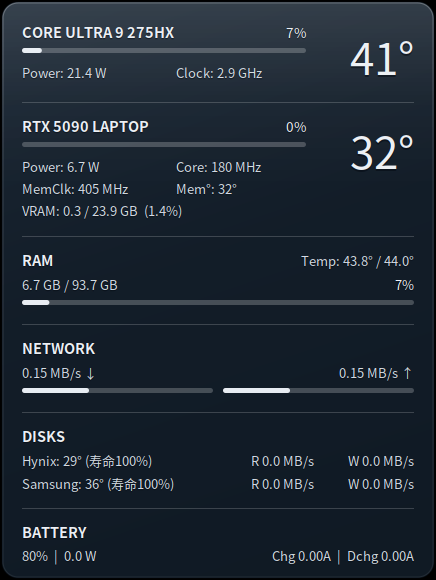

# Conky Hardware Monitor | Linux 桌面硬件监控面板

基于 **Conky + Lua/Cairo** 的 Linux（X11）半透明磨砂玻璃硬件监控桌面浮层，支持 **NVIDIA 显存温度（NVAPI）**、**DDR5 内存双条温度（SPD5118 纯只读 SMBus）**、**NVMe 寿命与读写速率**、**桌面工作区范围内左键拖动与位置记忆**，每 2 秒自动刷新。



*上图为 Ubuntu 24.04 X11（Core Ultra 9 275HX + RTX 5090 Laptop + 双通道 DDR5 + 双 NVMe）实机截图。*

## 功能特性

- **半透明磨砂圆角卡片**：基于 Cairo 矢量绘制，带有顶部玻璃微高光、细内描边、文字阴影与圆角进度条，不遮挡桌面视觉。
- **CPU 监控**：自动识别处理器型号、实时占用率与进度条、Intel RAPL 实时封装功耗（`Power`）、最高核心频率（`Clock`）及封装温度。
- **GPU 监控（NVIDIA）**：通过常驻轻量守护进程 `gpu_daemon.py` 调用 NVML + NVAPI，毫秒级轮询无卡顿：
  - 核心占用率、核心温度、实时功耗（`Power`）、核心频率（`Core`）
  - **显存频率（`MemClk`）** 与 **真实显存温度（`Mem°`，免 `sudo`）**
  - 显存已用 / 总容量与占比（`VRAM`）
- **RAM 监控**：已用/总内存及百分比进度条；支持读取双通道 **DDR5 内存实时温度**（优先读取 `/sys/class/hwmon` 的 `spd5118`/`jc42`，若主板启用了 `SPD Write Disable` 则自动回退到纯只读 SMBus `i2c-dev` 轮询）。
- **NETWORK 监控**：自动追踪当前默认路由网卡，实时显示下行 `↓` / 上行 `↑` 速率（固定 `MB/s` 显示）与对数双进度条。
- **DISKS 监控**：自动识别系统盘优先排序并提取品牌简称（如 `Hynix`、`Samsung`、`WD`、`Micron`、`Kioxia`、`Kingston`、`Solidigm`），显示温度、UDisks2 SMART 寿命百分比（`寿命100%`）及实时读写 `MB/s`。
- **BATTERY 监控**：显示电量百分比、实时功率（`W`）以及充/放电电流（`Chg / Dchg A`）。
- **左键拖动与位置记忆**：在面板任意位置按住鼠标左键即可拖动，自动限制在桌面工作区 `_NET_WORKAREA` 内（不会拖出屏幕或遮住顶部栏/Dock），松开后自动保存坐标到 `~/.config/conky/position.txt` 并在重启后恢复。
- **独立用户服务运行**：支持通过 `systemd --user`（`systemd-run --user`）独立托管运行，关闭终端标签页或编辑器都不会连带退出。

## 安装与运行

### 方式一：安装 `.deb` 系统包（Ubuntu / Debian 推荐）

从 [Releases](../../releases) 下载 `conky-hardware-monitor_1.0.0_all.deb` 后安装：

```bash
sudo apt install ./conky-hardware-monitor_1.0.0_all.deb
```

启动与常用命令：

```bash
conky-hardware-monitor                      # 以独立 systemd --user 服务启动
conky-hardware-monitor --install-autostart  # 开启登录自启 (~/.config/autostart)
conky-hardware-monitor --stop               # 停止监控
sudo conky-hardware-monitor --setup-sensors # 可选：一键开启 CPU 功耗与 DDR5 内存温度读取权限
```

### 方式二：绿色压缩包（`.tar.gz`）

从 [Releases](../../releases) 下载 `conky-hardware-monitor-v1.0.0-linux.tar.gz`，参见 [Linux 打包说明](packaging/linux/README.md)：

```bash
tar -xzf conky-hardware-monitor-v1.0.0-linux.tar.gz
cd conky-hardware-monitor-linux
./install.sh   # 安装到 ~/.config/conky 并设置开机自启（或仅运行 ./start.sh 试用）
```

如需在本地重新生成 `.tar.gz` 与 `.deb` 发布包：

```bash
python3 packaging/create_packages.py
```

生成产物位于 `dist/`。

## 可选：开启 CPU 功耗与 DDR5 内存温度权限

- **GPU 显存温度（`Mem°`）**、**GPU 各项指标**、**硬盘温度/寿命**、**网速**、**电池** 均无需额外权限即可显示。
- 若希望同时显示 **CPU 功耗（`intel-rapl`）** 与 **DDR5 内存温度（`spd5118` / `SMBus I801`）**，可执行一次脚本或手动配置（`.deb` 安装后也可直接执行 `sudo conky-hardware-monitor --setup-sensors`）：

```bash
# 1. 允许普通用户读取 Intel RAPL CPU 封装功耗
echo 'z /sys/class/powercap/intel-rapl:0/energy_uj 0444 root root -' | sudo tee /etc/tmpfiles.d/rapl-read.conf
sudo systemd-tmpfiles --create /etc/tmpfiles.d/rapl-read.conf

# 2. 加载 DDR5 温感模块，并授予 SMBus I801 只读设备访问权限（兼容开启 SPD Write Disable 的主板）
sudo modprobe spd5118
echo spd5118 | sudo tee /etc/modules-load.d/spd5118.conf
echo "SUBSYSTEM==\"i2c-dev\", ATTR{name}==\"SMBus I801*\", MODE=\"0660\", GROUP=\"$USER\"" | sudo tee /etc/udev/rules.d/99-smbus-ram-temp.rules
sudo udevadm control --reload-rules && sudo udevadm trigger --subsystem-match=i2c-dev
```

## 引用、参考与借鉴

- **界面排版与视觉设计参考**：借鉴了用户提供的 Windows 桌面硬件监控浮层截图（极简透明面板、右侧大号温度数字、分栏指标与细进度条排版），在 Linux X11 下用 Conky + Lua/Cairo 从零重构，并扩展为半透明钢蓝磨砂玻璃卡片与左键拖动定位。
- **NVIDIA 显存温度读取方案参考**：参考了开源项目 [LACT (Linux GPU Configuration and Monitoring Tool)](https://github.com/ilya-zlobintsev/LACT) 与 Linux NVIDIA 社区对 `libnvidia-api.so.1`（NVAPI `nvapi_QueryInterface` 私有热通道接口 `0x0BC8163D` / `0x65FE3AAD`）的技术探索，实现在 RTX 50 系列 Linux 驱动下免 `sudo` 读取真实显存温度（`Mem°`）。
- **DDR5 内存温度协议与内核兼容性参考**：参考 Linux 内核 [`drivers/hwmon/spd5118.c`](https://git.kernel.org/pub/scm/linux/kernel/git/torvalds/linux.git/tree/drivers/hwmon/spd5118.c) 源码及 JEDEC JESD300-5（SPD5118）寄存器定义（`MR0:MR1 = 0x5118`、`MR49:MR50 = 0x31:0x32` 温度补码解码），采用纯只读 SMBus ioctl 读取方式，规避部分笔记本 BIOS 开启 `SPD Write Disable` 导致内核跳过自动绑定或休眠唤醒异常的问题。
- **Linux 打包与项目结构借鉴**：借鉴了 [rzls420420/gemini-desktop-pet](https://github.com/rzls420420/gemini-desktop-pet) 与 [rzls420420/codex-desktop-pet](https://github.com/rzls420420/codex-desktop-pet) 的 `packaging/linux/`、`dist/` 及文档规范。
- **底层依赖与系统接口**：[Conky](https://github.com/brndnmtthws/conky)（Cairo/Lua X11 绑定）、Linux `sysfs`/`procfs`/`powercap`/`i2c-dev`、UDisks2 D-Bus NVMe SMART 接口、`libnvidia-ml.so.1`（NVML）与 `Noto Sans CJK SC` 字体。

本项目原创代码遵循 **MIT 协议**，详见 [LICENSE](LICENSE) 与 [NOTICE.md](NOTICE.md)。
